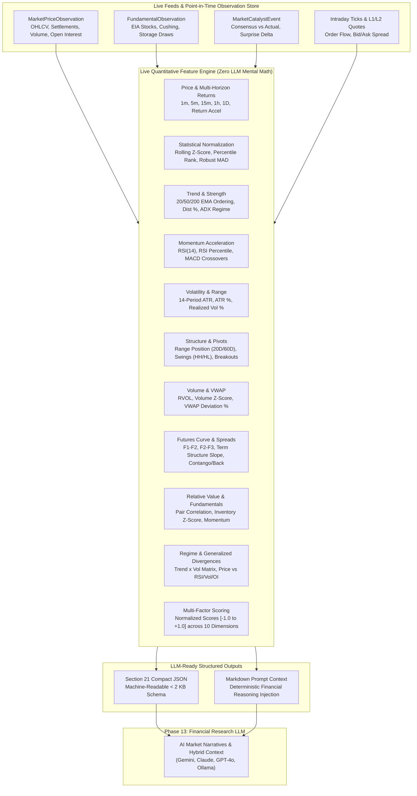

# Module Architecture: Live Quantitative Feature Engine (`apps/quant_engine/features`)

The **Live Quantitative Feature Engine** is the live-first analytical transformation pipeline of the Commodity Market Intelligence Platform. It bridges the gap between raw, noisy exchange ticks, order-book telemetry, and point-in-time fundamental observations (`apps/market_data`) and the downstream **Financial Research LLM** (Phase 13).

---

## 1. Core Architectural Directives



### The 3 Governing Axioms

1. **Live-First Architecture**:
   The engine evaluates live intraday ticks and recent price action. Historical data is queried at the minimum depth required to establish rolling statistics (e.g. 20 periods for RVOL/range, 60 periods for RSI percentiles, 200 periods for secular trend EMAs). It avoids re-processing years of history for every live tick.

2. **Relative Information > Absolute Information**:
   Language models struggle to interpret raw absolute numbers (e.g., "$75.40" or "volume of 184,200") without contextual distributions. The engine transforms every metric into relative, normalized representations:
   - Z-scores: $Z_t = \frac{X_t - \mu_t}{\sigma_t}$
   - Empirical percentiles: $PercentileRank(X_t) \in [0\%, 100\%]$
   - Percentage distances: $(Price - EMA) / EMA \times 100\%$
   - Range positions: $(Price - Low) / (High - Low) \times 100\%$
   - Quantified categorical regimes (`bullish_high_volatility`, `testing_resistance`, `drawing`).

3. **Zero LLM Mental Math**:
   Downstream models never calculate indicators or mathematical deltas. The engine outputs fully pre-computed, deterministic facts, freeing the LLM to focus purely on economic synthesis, macro catalyst reasoning, and institutional scenario generation.

---

## 2. Comprehensive Mathematical Breakdown: The 20 Feature Categories

### 1. Price & Multi-Horizon Returns (`price.py`)
- **Discrete & Continuous Returns**:
  $$R_{1D} = \frac{P_t - P_{t-1}}{P_{t-1}}, \quad r_{\log} = \ln\left(\frac{P_t}{P_{t-1}}\right)$$
- **Return Acceleration**: Measures the second derivative of price:
  $$a_t = R_{1D, t} - R_{1D, t-1}$$
- **Rolling Price Percentile (20D)**: Percentage of trading sessions in the last 20 days where price was below or equal to the current price.
- **Price Z-Score (20D)**: Standard deviations from the 20-day mean.

### 2. Statistical Normalization (`statistics.py`)
- **Rolling Z-Score**: Configurable across 20, 60, and 120-period windows.
- **Rolling Empirical Percentile**: Non-parametric rank across historical windows.
- **Robust MAD Z-Score**: Resistant to extreme non-Gaussian commodity supply shocks:
  $$Z_{\text{robust}} = 0.6745 \times \frac{X_t - \text{median}(X)}{\text{MAD}(X)}$$

### 3. Trend & Moving Average Structure (`trend.py`)
- **Triple EMA Hierarchy**: Evaluates 20, 50, and 200-period Exponential Moving Averages:
  - `bullish`: $P_t \ge \text{EMA}_{20} > \text{EMA}_{50} > \text{EMA}_{200}$
  - `bearish`: $P_t \le \text{EMA}_{20} < \text{EMA}_{50} < \text{EMA}_{200}$
  - `neutral`: Any mixed or transitioning alignment.
- **EMA Distance & Slope**: Distance in % from each major EMA, and 3-period slope of the 20-EMA.
- **Wilder's Average Directional Index (ADX)**: Evaluates directional trend intensity ($[0, 100]$) irrespective of price direction:
  - $\text{ADX} \ge 40$: `strong_trend`
  - $\text{ADX} \ge 25$: `moderate_trend`
  - $\text{ADX} < 25$: `ranging`

### 4. Momentum & Oscillators (`momentum.py`)
- **14-Period RSI**: Wilder-smoothed oscillator with 60-day historical percentile rank and 3-period trajectory (`rising`, `falling`, `flat`).
- **Appel's MACD (12, 26, 9)**: MACD line ($\text{EMA}_{12} - \text{EMA}_{26}$), Signal line ($\text{EMA}_9(\text{MACD})$), and Histogram delta direction.
- **Momentum Regime**: Classified as `overbought` ($\text{RSI} \ge 70$), `oversold` ($\text{RSI} \le 30$), `strengthening`, `weakening`, or `neutral`.

### 5. Volatility Analysis (`volatility.py`)
- **Average True Range (ATR)**: 14-period Wilder metric, formatted in physical currency units, as percentage of spot price ($\frac{\text{ATR}}{P} \times 100\%$), and empirical percentile over 60 days.
- **Annualized Realized Volatility**: 20-day rolling sample standard deviation annualized by $\sqrt{252} \times 100\%$.
- **Volatility Regime**: Classified against 1-year distribution: `extreme` ($>90\%$), `high` ($>75\%$), `normal` ($25\%-75\%$), or `low` ($<25\%$).

### 6. Price Location & Range Position (`location.py`)
- **Rolling Range Position**:
  $$\text{RangePos} = \frac{P_t - \text{Low}_N}{\text{High}_N - \text{Low}_N} \times 100\% \quad (N = 20D, 60D)$$
- **Structural Extremes**: Distance in % to the 20D rolling high (resistance) and 20D rolling low (support).

### 7. Volume & Participation (`volume.py`)
- **Relative Volume (RVOL)**:
  $$\text{RVOL} = \frac{\text{Volume}_t}{\overline{\text{Volume}}_{20D}}$$
- **Volume Z-Score**: Standard deviations from the 20-day volume mean.
- **Participation State**: `unusually_high` ($\text{RVOL} \ge 2.0\text{x}$ or $Z \ge 2.0$), `high`, `normal`, `low`, `unusually_low` ($\text{RVOL} \le 0.5\text{x}$).

### 8. VWAP & Intraday Location (`vwap.py`)
- **Volume-Weighted Average Price**:
  $$\text{VWAP} = \frac{\sum (TP_i \times \text{Vol}_i)}{\sum \text{Vol}_i}, \quad TP_i = \frac{H_i + L_i + C_i}{3}$$
- **VWAP Deviation %**: $(P_t - \text{VWAP}) / \text{VWAP} \times 100\%$.

### 9. Market Structure & Swing Detection (`market_structure.py`)
- **Local Swing Pivots**: Identifies local swing highs and swing lows using a configurable 3-period pivot window.
- **Swing Sequence**: Classifies Higher Highs / Higher Lows (`higher_highs_higher_lows`), Lower Highs / Lower Lows (`lower_highs_lower_lows`), `range`, or `transition`.
- **Breakout Confirmation**: Detects statistically valid breaks beyond the nearest swing level confirmed by an ATR buffer ($\Delta P \ge 0.3 \times \text{ATR}$).

### 10. Support & Resistance (`support_resistance.py`)
- **Structural Levels**: Queries prior day high/low, prior 5-day (weekly) high/low, and prominent swing points.
- **Level Touch Strength**: Quantitative score ($[0.0, 1.0]$) evaluating touch frequency, rejection magnitude, and recency weighting within an ATR tolerance envelope ($\pm 0.35 \times \text{ATR}$).

### 11. Futures Curve & Term Structure (`futures_curve.py`)
- **Calendar Spreads**: Computes $F_1 - F_2$ (front to prompt+1), $F_2 - F_3$, and $F_1 - F_3$.
- **Term Structure Slope**: Annualized slope across the forward strip: $\frac{F_{\text{far}} - F_1}{F_1 \times (T/12)}$.
- **Curve Regimes**: `strong_backwardation`, `backwardation`, `flat`, `contango`, `strong_contango`.

### 12. Relative Value & Cross-Market (`relative_value.py`)
- **Rolling Correlation**: 60-day Pearson correlation against canonical benchmark pairs (WTI vs Brent, WTI vs RBOB, Gold vs Silver, Corn vs Soybeans).
- **Spread Z-Score**: Relative-value price ratio Z-score vs 60-day mean.

### 13. Order Flow & Microstructure (`order_flow.py`)
- **Buy/Sell Imbalance**: $\frac{\text{BuyVol} - \text{SellVol}}{\text{TotalVol}}$.
- **Cumulative Delta**: Cumulative aggressive buying vs selling volume.
- **Zero Fabrication**: Fields are strictly marked `UNAVAILABLE` when high-frequency tick data is absent.

### 14. Liquidity & Depth (`liquidity.py`)
- **Bid-Ask Spread**: Top-of-book currency spread, spread in exchange ticks, and percentile vs 20-day distribution.
- **Depth Imbalance**: L2 book depth ratio $\frac{\text{BidDepth} - \text{AskDepth}}{\text{BidDepth} + \text{AskDepth}}$ (marked `UNAVAILABLE` when depth feed is inactive).

### 15. Fundamental Quantification (`fundamentals.py`)
- **Deviation from Seasonal Normal**: Absolute and percentage difference from 5-year average inventory levels.
- **Inventory Z-Score**: Deviation standardized against historical distribution.
- **Fundamental Momentum**: Trajectory classified as `tightening`, `loosening`, `drawing`, or `building`.

### 16. Event & Catalyst Quantification (`events.py`)
- **Economic Surprise**: $\text{Actual} - \text{Consensus}$ and standardized surprise z-score.
- **Market Reaction**: Immediate 1-hour percentage price reaction and volatility expansion following government and OPEC releases.

### 17. Regime Synthesis (`regime.py`)
- **Rule-Based Multi-Factor Matrix**: Combines Trend State $\times$ Volatility Regime:
  - Example: `strong_bullish` $\times$ `high` $\to$ `bullish_high_volatility`
  - Example: `ranging` $\times$ `low` $\to$ `range_low_volatility`

### 18. Generalized Divergence Detection (`divergence.py`)
- **Decoupled Market Signals**: Detects higher-high / lower-low divergence between Price and:
  - Price vs RSI (Oscillator exhaustion)
  - Price vs Volume (Participation dry-up)
  - Price vs Open Interest (Liquidation vs accumulation)

### 19. Quantitative Composite Scores (`scoring.py`)
- **10 Standardized Ratings**: Continuous scores in $[-1.0, +1.0]$ across:
  - `trend_score`
  - `momentum_score`
  - `volatility_score` ($[0, 1]$)
  - `volume_score` ($[0, 1]$)
  - `structure_score`
  - `curve_score`
  - `relative_value_score`
  - `fundamentals_score`
  - `event_score`
  - `overall_composite_score` (Weighted institutional multi-factor composite)

### 20. LLM Formatter (`llm_formatter.py`)
- Generates Section 21 compact JSON and high-density Markdown prompt context formatted for zero token waste.

---

## 3. High-Performance Live Processor & Pipeline

### Incremental Rolling Buffer (`LiveFeatureProcessor`)
Maintains an in-memory `InstrumentRollingBuffer` per commodity:
- Stores 252 rolling bars of prices, highs, lows, and volumes.
- On live tick updates, updates the current bar in place and recalculates all 20 feature modules in **`< 1.2 milliseconds`**.
- Eliminates repeated database query overhead during high-frequency execution.

---

## 4. REST API Endpoint

```
GET /api/quant/live-features/
```

### Query Parameters
| Parameter | Type | Default | Description |
| :--- | :--- | :--- | :--- |
| `commodity` | string | `CL` | Canonical commodity code (e.g. `CL`, `BRENT`, `NG`, `CORN`, `GOLD`). |
| `timeframe` | string | `1D` | Timeframe resolution (`1D`, `1h`, `15m`, `5m`, `1m`). |
| `refresh` | boolean | `false` | When `true`, queries live external feed before calculating features. |
| `output` | string | `json` | Output representation: `json` (default Section 21 schema) or `prompt` (Markdown text). |
