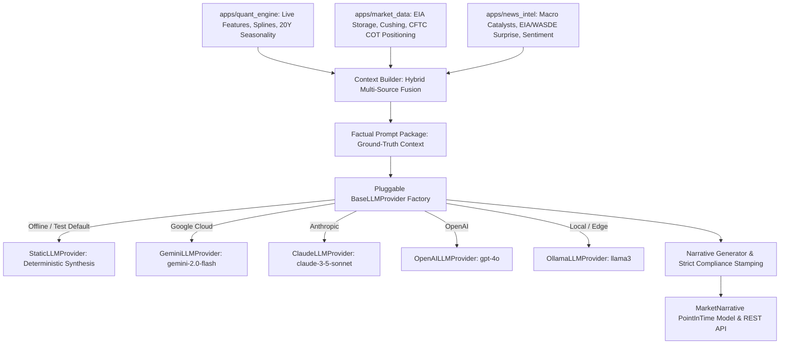
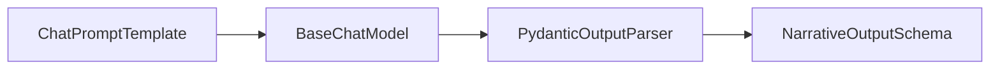

# AI Market Narratives & Hybrid Context Engine (`apps.narratives`)

---

## 1. Executive Summary & Architectural Mission

The **AI Market Narratives & Hybrid Context Engine** serves as the automated financial research, executive intelligence, and institutional surveillance layer for global commodity derivatives.

Traditional LLM implementations in financial analysis suffer from two fatal vulnerabilities:
1. **Mathematical Hallucination**: Large Language Models perform erratic mental arithmetic when calculating calendar spreads, multi-horizon returns, or volatility percentiles.
2. **Lookahead & Data Decoupling**: Language models ingest unversioned news and market commentary without point-in-time synchronization with forward curves and physical balances.

To address these vulnerabilities, `apps.narratives` strictly adheres to **Core Directive 3 (Deterministic Arithmetic Precedes LLM Reasoning)** and **Core Directive 2 (Point-in-Time Correctness)**:
- **Zero Mental Math**: All multi-horizon returns, realized volatility regimes, ATR values, 20Y seasonality tenure win rates, PCHIP spline forward curves, and CFTC positioning metrics are computed deterministically by `apps.quant_engine` before any prompt is assembled.
- **Strict Ground-Truth Evidence Package**: The Context Builder aggregates and freezes numerical features, macro catalyst prints, and news sentiment into an immutable Section 21 prompt package.
- **Pluggable LLM Provider Contract**: Isolated behind an abstract provider interface (`BaseLLMProvider`), allowing hot-swapping between **Static (Offline Deterministic)**, **Google Gemini 2.0 Flash**, **Anthropic Claude 3.5 Sonnet**, **OpenAI GPT-4o**, and local **Ollama (Llama 3)** without changing downstream logic.
- **Automated Regulatory Compliance**: Every generated briefing and flash alert is automatically stamped with the institutional non-advice regulatory notice (Directive 4).



---

## 2. Domain Data Models

The persistence layer (`apps.narratives.models`) extends `UUIDModel` and `PointInTimeModel`:

### `MarketNarrative`

| Field | Type | Description |
| :--- | :--- | :--- |
| `id` | `UUIDField` | Primary key identifier (RFC 4122 v4). |
| `commodity` | `ForeignKey` | Target `CommodityMaster` (null for cross-commodity / macro briefs). |
| `narrative_type` | `CharField` | Categorical briefing type: `MORNING_BRIEF`, `EXECUTIVE_FLASH`, `SUPPLY_DEMAND`, `RISK_ALERT`, `OUTLIER_DIVERGENCE`. |
| `headline` | `CharField(255)` | Institutional research headline summarizing key market dynamic. |
| `executive_summary` | `TextField` | Concise 2-3 sentence executive synopsis. |
| `market_context_body` | `TextField` | Structured Markdown narrative covering market structure, term structure, fundamentals, and catalysts. |
| `key_bullet_points` | `JSONField` | List of high-conviction quantitative takeaway bullets. |
| `risk_factors` | `JSONField` | Explicit surveillance risk vectors, asymmetries, and catalyst triggers. |
| `evidence_snapshot` | `JSONField` | Immutable snapshot of the normalized quantitative context ingested during generation. |
| `llm_provider` | `CharField(64)` | Provider adapter identifier (e.g. `static`, `gemini`, `claude`, `openai`, `ollama`). |
| `llm_model` | `CharField(64)` | Model version identifier (e.g. `gemini-2.0-flash`, `claude-3-5-sonnet-20241022`). |
| `prompt_tokens` | `PositiveIntegerField` | Token count of input prompt context. |
| `completion_tokens`| `PositiveIntegerField` | Token count of generated output. |
| `status` | `CharField(16)` | Lifecycle state: `DRAFT`, `PUBLISHED`, `ARCHIVED`. |
| `compliance_disclaimer` | `TextField` | Non-negotiable standard regulatory compliance notice. |
| `availability_time` | `DateTimeField` | Exact point-in-time when data became accessible to the market. |

---

## 3. LangChain LCEL Architecture & Pluggable Providers

Every LLM integration in `apps.narratives` is powered by the **LangChain Expression Language (LCEL)** pipeline:



```python
# apps/narratives/chains/narrative_chain.py
prompt = ChatPromptTemplate.from_messages([
    ("system", SYSTEM_RESEARCH_INSTRUCTION),
    ("human", "{evidence_context}\n\nFormat your output strictly according to:\n{format_instructions}"),
])
parser = PydanticOutputParser(pydantic_object=NarrativeOutputSchema)
chain = prompt | chat_model | parser
```

### Supported LangChain Chat Models

1. **`StaticLangChainChatModel` (`static`)**:
   - LangChain `BaseChatModel` implementation providing deterministic financial report synthesis directly from ground-truth evidence.
   - Evaluates multi-factor composite scores, contango/backwardation slopes, RSI percentiles, and divergences to generate high-grade institutional research.
   - Serves as the default offline provider, ensuring 100% test suite reliability without API keys.
2. **`GeminiLangChainChatModel` (`gemini`)**:
   - Google Gemini 2.0 / 1.5 Flash via REST API using `httpx`.
   - Utilizes strict JSON response schema generation.
   - Automatic fallback to `StaticLangChainChatModel` if `GEMINI_API_KEY` is absent or remote service times out.
3. **`ClaudeLangChainChatModel` (`claude`)**:
   - Anthropic Claude 3.5 Sonnet via `/v1/messages`.
   - High-precision macro reasoning with graceful offline fallback.
4. **`OpenAILangChainChatModel` (`openai`)**:
   - OpenAI GPT-4o via `/v1/chat/completions` with JSON Mode enforcement.
5. **`OllamaLangChainChatModel` (`ollama`)**:
   - Local on-premise execution via `http://localhost:11434/api/generate` with zero data egress.

---

## 4. Hybrid Context Compilation Engine

The Context Builder (`apps.narratives.services.context_builder.build_narrative_context`) gathers verified inputs across 4 platform sub-systems:

1. **Vectorized Quantitative Evidence**:
   - Spot settlement price and multi-horizon returns (1D, 5D, 21D, 63D).
   - Realized volatility % and regime classification.
   - Forward curve term structure slope (`STRONG_BACKWARDATION`, `CONTANGO`), prompt spread (M1-M2), and 1-year roll yield.
2. **Real-Time Technical Indicator Posture**:
   - Triple EMA structure (20, 50, 200 EMA), slope, and Wilder ADX(14) trend state.
   - Wilder RSI(14) percentile and Appel MACD momentum state.
   - Relative Volume (RVOL) and Volume Shock Z-score.
3. **Physical Fundamentals & Inventory Balances**:
   - Reported inventory levels (e.g. EIA Cushing Crude Stocks, Natural Gas Underground Storage).
   - Seasonal percentile vs. 5-year historical normal and physical balance regime.
4. **CFTC Commitment of Traders (COT)**:
   - Disaggregated speculative positioning: Managed Money Net, Commercial Net, and positioning crowding regime.
5. **Macro Catalysts & Sentiment Wire**:
   - Scheduled high-impact releases (OPEC meetings, USDA WASDE, FOMC rate decisions, EIA Weekly Petroleum).
   - Tagged news flow with commodity-specific sentiment polarity scores.

---

## 5. Management Commands & Operational Workflows

### Seeding Baseline Market Narratives
Seed baseline morning briefings, supply/demand balance commentaries, and risk alerts idempotently for benchmark commodities (`CL`, `BRENT`, `NG`, `GOLD`, `CORN`):

```powershell
.\.venv\Scripts\python.exe manage.py seed_narratives --clear
```

### On-Demand Narrative Generation via CLI
Generate an evidence-grounded briefing on demand:

```powershell
# Generate WTI Morning Briefing using default provider
.\.venv\Scripts\python.exe manage.py generate_narrative --commodity CL --type MORNING_BRIEF

# Generate Natural Gas Risk Alert using Gemini
.\.venv\Scripts\python.exe manage.py generate_narrative --commodity NG --type RISK_ALERT --provider gemini

# Generate Gold Executive Flash using Ollama
.\.venv\Scripts\python.exe manage.py generate_narrative --commodity GOLD --type EXECUTIVE_FLASH --provider ollama
```

---

## 6. Regulatory Compliance Guarantee

All published narratives systematically embed the mandatory regulatory notice:

> **STANDARD REGULATORY COMPLIANCE NOTICE**: This automated market briefing is strictly an analytical research, quantitative surveillance, and intelligence workflow tool. It does NOT constitute financial, investment, or trading advice, nor an offer, solicitation, or recommendation to buy, sell, or hold any commodity derivative, futures contract, or security. All quantitative metrics, forward curve models, and narrative syntheses are generated systematically and carry inherent market risks.
